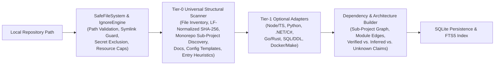

# ContextForge — Architecture & Technology Decision Record

## 1. System Overview
ContextForge is a local-first, stack-agnostic developer workspace that analyzes arbitrary local repositories, tracks source-linked project knowledge with staleness detection, builds deterministic token-budgeted context packs for AI coding assistants, and conducts evidence-backed Git change reviews.

## 2. Technology Decision Record (ADR-001)
- **Language & Runtime**: TypeScript 5.7 (`strict: true`, `noUncheckedIndexedAccess: true`) on Node.js 24.
- **Persistence & Search Index**: Node.js built-in `node:sqlite` (`DatabaseSync` with SQLite FTS5) — zero native addon compilation required, transactional snapshot storage, fast full-text indexing, and deterministic 1-click index deletion.
- **Backend Server**: Node.js native `node:http` typed JSON REST server with zero external runtime framework dependencies.
- **Frontend Workspace**: React 19 + Vite with a keyboard-accessible, responsive developer UI covering all 9 operational views.
- **Test Harness**: Vitest covering unit tests, polyglot fixture integration tests, determinism checks, and adversarial security boundary tests.

## 3. Two-Tier Repository Analysis Pipeline

### Why Tier-0 + Tier-1 Ensures Stack Independence
- **Tier-0 Universal Scanner** makes zero assumptions about programming languages. It operates on file roles, directory hierarchies, workspace boundaries, README/documentation files, configuration templates, and Git metadata. Even on an unknown language (e.g., `.xyz` custom DSL), Tier-0 produces a navigable inventory, searchable files, staleness-tracked knowledge, and deterministic context packs.
- **Tier-1 Adapters** implement `RepositoryAnalyzerAdapter`. Each adapter declares its capabilities (`detectsManifests`, `extractsSymbols`, `extractsModuleImports`, `detectsEntryPoints`, `detectsApiSurfaces`, `analyzesSqlObjects`, `inspectsDiffRisks`) and emits `EvidenceBackedClaim<T>` items tagged with exact `SourceReference` line ranges and `fileSha256` fingerprints.

## 4. Deterministic Context Assembly & Prompt Injection Defense
1. **Budget Allocation**: Context budgets are split across task instructions/constraints, verified architecture facts, relevant project knowledge/ADRs, primary & neighbor source files, and covering tests.
2. **Deterministic Scoring**: Candidate files are scored reproducibly using explicit rules:
   - Seed file match (`+500`)
   - Direct 1-hop import/dependency of seed file (`+260`)
   - Associated test file for seed/changed module (`+220`)
   - Same sub-project manifest or entry point (`+150`)
   - Keyword/FTS relevance to task description (`+0..180`)
   - Tie-breaking: descending score, then ascending POSIX `relativePath`.
3. **Untrusted Content Fencing**: Exported source snippets are wrapped in `<untrusted_repository_content>` blocks with escaped boundary tags, accompanied by prompt-injection warnings when suspicious imperative overrides or hidden bidirectional Unicode characters are detected.

## 5. Security & Platform Invariants
- **No Code Execution**: ContextForge never executes project build scripts, package managers, database migrations, or Git hooks (`-c core.hooksPath=_cf_disabled_`).
- **Cross-Platform Determinism**: All internal paths are normalized to POSIX forward slashes (`relativePath`), and all file hashes (`fileSha256`) are computed over `\n`-normalized text (after UTF-8/UTF-16 BOM decoding) so Windows (`CRLF`) and Linux/macOS (`LF`) checkouts produce identical fingerprints and line numbers.
- **Explicit Outbound Consent**: External AI providers cannot be called without a user-signed `OutboundConsentToken` matching the exact SHA-256 hash of the outbound prompt payload.
